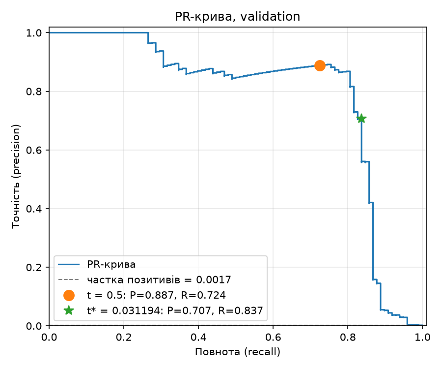
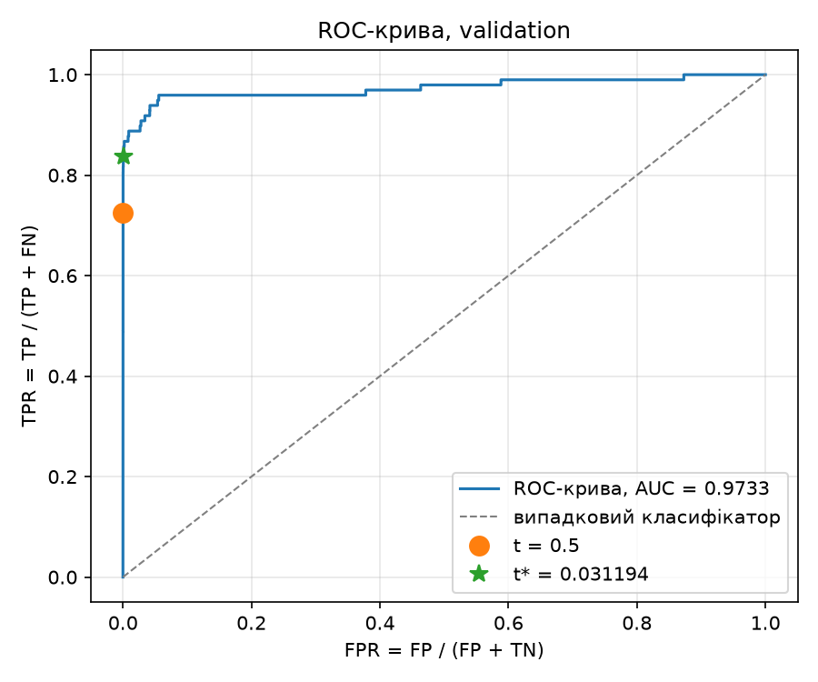

# ЛР2. Поріг рішення під асиметричну ціну помилок

**Виконала:** Артеменко Олександра

Набір даних: [Credit Card Fraud Detection (Kaggle, mlg-ulb/creditcardfraud)](https://www.kaggle.com/datasets/mlg-ulb/creditcardfraud), файл `creditcard.csv` (284 807 транзакцій, 492 шахрайські). Сам CSV до репозиторію не додано.

Стек: Python 3.12, NumPy 2.5.4, pandas 3.0.6, scikit-learn 1.9.1, PyTorch 2.14.1, Matplotlib 3.11.2. Навчання на CPU у float32.

---

## 1. Як запускати

### 1.1. Встановлення середовища

Потрібен [uv](https://docs.astral.sh/uv/). Усі версії зафіксовано в `pyproject.toml` і `uv.lock`.

```bash
cd lab2
uv sync            # створить .venv з Python 3.12 і точними версіями залежностей
```

### 1.2. Аналіз зі збережених прогнозів (пункти 2–4, без CSV і без навчання)

```bash
uv run python analysis.py --saved results --out outputs
```

Команда читає `results/predictions.npz`, будує криві, шукає `t*` на validation, проганяє перевірки A/B/C і лише після їх успішного проходження оцінює test. Усі таблиці й графіки записуються в `outputs/` (тека перезаписується; результат детермінований і збігається з наведеним нижче).

Швидка перевірка, що збережені дані читаються (стартовий код):

```bash
uv run python lab2_starter.py --saved results
```

### 1.3. Навчання з локального CSV

Завантажте `creditcard.csv` з Kaggle (потрібен обліковий запис) і передайте шлях до нього через `--data`. Оскільки `results/` уже містить збережені прогнози, а стартовий код не перезаписує непорожню теку, для повторного навчання вкажіть нову теку:

```bash
uv run python lab2_starter.py --data /шлях/до/creditcard.csv --out results_retrain
uv run python analysis.py --saved results_retrain --out outputs_retrain   # аналіз нового запуску
```

Повторне навчання дає той самий поділ і ті самі статистики стандартизації; оцінки моделі можуть відрізнятися в молодших розрядах залежно від версії PyTorch і платформи. Висновки звіту зроблено за збереженими прогнозами в `results/`.

### 1.4. Структура теки

| Файл | Призначення |
|---|---|
| `lab2_starter.py` | стартовий код викладача: поділ, стандартизація, навчання, збереження (без змін) |
| `thresholds.py` | власна реалізація: матриця плутанини, `C(t)`, швидкий пошук порога, незалежний перебір |
| `analysis.py` | пункти 2–4: криві, таблиця кандидатів, перевірки A/B/C, test, розбір помилок |
| `pyproject.toml`, `uv.lock`, `.python-version` | зафіксоване середовище |
| `results/model.pt` | ваги моделі після 12-ї епохи |
| `results/predictions.npz` | індекси поділу (`*_row_ids`), мітки, `Amount`, оцінки validation/test без округлення |
| `results/preprocessing.npz`, `results/run.json` | статистики `StandardScaler` (лише train), параметри та версії запуску |
| `outputs/pr_curve_validation.png`, `outputs/roc_curve_validation.png` | PR- і ROC-криві на validation |
| `outputs/validation_thresholds.csv` | повна таблиця кандидатів: поріг, TP, FP, FN, TN, C |
| `outputs/threshold.json` | зафіксований поріг `t*` (точне значення) |
| `outputs/validation_comparison.csv` | порівняння порогів 0.5, `t*`, `+inf` |
| `outputs/check_A.csv`, `check_B.csv`, `check_C.csv` | результати перевірок пошуку |
| `outputs/test_errors_first5.csv`, `test_errors_all.csv` | розбір помилок на test |
| `outputs/summary.json` | усі підсумкові числа |

---

## 2. Дані, поділ і навчання

Ознаки: 29 стовпців `V1–V28` і `Amount`. `Class` (ціль) і `Time` до входу моделі не входять. Сире `Amount` збережено окремо для аналізу помилок.

Поділ індексів рядків CSV (порядок рядків збережено, нумерація від 0 без заголовка):
1. `train_test_split(idx, test_size=0.4, stratify=Class, random_state=0)` → train (60 %) і відкладені 40 %;
2. відкладені індекси — `train_test_split(..., test_size=0.5, stratify=мітки, random_state=0)`: перша частина validation, друга test.

| Вибірка | Об'єктів | Шахрайських | Частка шахрайських |
|---|---:|---:|---:|
| train | 170 884 | 295 | 0,1726 % |
| validation | 56 961 | 98 | 0,1720 % |
| test | 56 962 | 99 | 0,1738 % |

Стратифікація зберегла частку шахрайства ≈ 0,17 % у всіх трьох частинах. Класи не балансувалися.

Модель `Linear(29,32) → ReLU → Linear(32,1)`, `BCEWithLogitsLoss` (середнє за пакетом, без ваг класів), Adam з `lr = 1e-3`, 12 епох, пакет 1024 (останній неповний пакет не відкидається), `torch.manual_seed(0)`, окремий `np.random.default_rng(0)` для перемішування на кожній епосі. Використано ваги після 12-ї епохи (BCE на train на останній епосі ≈ 0,00338). Оцінки `s_i = sigmoid(z_i)` отримано в режимі `eval()` під `torch.no_grad()`.

**Чому статистики стандартизації не можна рахувати на всьому наборі.** `StandardScaler` — це теж «навчання»: середнє й дисперсія оцінюються з даних. Якщо порахувати їх на всіх рядках, у підготовку train потрапить інформація з validation і test (витік даних). Особливо це стосується `Amount` з важким хвостом: кілька великих сум у test змістили б середнє й масштаб для всіх. Тоді validation і test перестають бути «новими» даними, оцінка якості й підбір порога стають оптимістично зміщеними і не відповідають реальному застосуванню, де майбутні транзакції невідомі. Тому scaler навчено лише на train і ті самі `mean_`/`scale_` застосовано до validation і test.

---

## 3. Вибір порога на validation

### 3.1. Формули

Прогноз «шахрайство», якщо `s_i ≥ t`.

- `TP(t) = #{i: s_i ≥ t, y_i = 1}`, `FP(t) = #{i: s_i ≥ t, y_i = 0}`
- `FN(t) = #{i: s_i < t, y_i = 1}`, `TN(t) = #{i: s_i < t, y_i = 0}`
- Вартість: **`C(t) = 10·FN(t) + FP(t)`** (пропущене шахрайство в 10 разів дорожче за хибну тривогу; `Amount` у формулу не входить).
- `precision = TP / (TP + FP)`, `recall = TP / (TP + FN)`; якщо знаменник дорівнює 0, метрика не визначена.

### 3.2. Криві та ROC-AUC

 

На validation **ROC-AUC = 0,9733** (average precision = 0,7847; частка позитивів 0,0017).

**Чому висока ROC-AUC не гарантує малої вартості чи високої точності.** ROC-AUC — це ймовірність того, що випадковий шахрайський об'єкт отримає вищу оцінку за випадковий легітимний; вона описує якість ранжування на всіх порогах одразу й не залежить ні від конкретного порога, ні від ціни помилок. Крім того, вісь FPR нормована на кількість негативних (56 863), тож навіть дуже мала FPR означає десятки хибних тривог: при `t*` FPR ≈ 0,0006, але FP = 34 на 82 TP, і точність лише 0,71. Точність залежить від частки класу, якої ROC-крива «не бачить», а вартість залежить від того, в якій точці кривої ми працюємо. Модель з AUC 0,97 із невдалим порогом (наприклад, `+inf` чи 0,5 тут) може мати набагато більшу `C`, ніж та сама модель з добре вибраним порогом.

### 3.3. Пошук порога

Кандидати — усі унікальні оцінки validation і `+inf` (`+inf` = «усі негативні», найменша оцінка = «усі позитивні»). Алгоритм (`thresholds.threshold_table`), `O(n log n)`:

1. Відсортувати оцінки за спаданням (`argsort`), разом із мітками.
2. Порахувати кумулятивні суми `cumsum(y)` (кількість позитивів) і `cumsum(1−y)` (кількість негативів) серед перших `k` за спаданням.
3. Знайти кінці груп рівних оцінок. Для порога `t = u` позитивними є всі об'єкти з `s ≥ u`, тобто вся група `u` і все вище, тому `TP(u)` і `FP(u)` беруться в останньому елементі групи. Так рівні оцінки завжди отримують однаковий прогноз.
4. `FN = P − TP`, `TN = N − FP`, `C = 10·FN + FP`; перший рядок — `t = +inf` з `TP = FP = 0`.
5. `t*` = кандидат з мінімальною `C`; якщо мінімум досягається на кількох порогах, береться **найбільший** (`+inf` — найбільший можливий).

Повторного проходу вибіркою для кожного порога немає. Додатково в коді: значення в `t*` і на 300 випадкових кандидатах звірено з прямим підрахунком за правилом `s ≥ t`.

Повна таблиця: `outputs/validation_thresholds.csv` — 55 993 кандидати (55 992 унікальні оцінки + `+inf`), значення без округлення. Мінімум вартості досягається на одному порозі.

**Зафіксований поріг:** `t* = 0.031193997710943222` (точне значення float32-оцінки; також у `outputs/threshold.json`).

### 3.4. Порівняння на validation

| Правило на validation | Поріг | TP | FP | FN | TN | C | Precision | Recall |
|---|---:|---:|---:|---:|---:|---:|---:|---:|
| Стандартний поріг | 0,5 | 71 | 9 | 27 | 56 854 | 279 | 0,887 | 0,724 |
| Мінімум вартості | `t*` ≈ 0,031194 | 82 | 34 | 16 | 56 829 | **194** | 0,707 | 0,837 |
| Усі негативні | `+inf` | 0 | 0 | 98 | 56 863 | 980 | не визначена | 0,000 |

Зниження порога з 0,5 до `t*` знайшло ще 11 шахрайств (FN 27 → 16, −110 у вартості) ціною 25 додаткових хибних тривог (+25), разом `C` 279 → 194. Для `+inf` точність не визначена, бо немає жодного позитивного прогнозу (`TP + FP = 0`).

---

## 4. Перевірка пошуку на малих наборах

Перевірочна реалізація (`thresholds.brute_force_table`) незалежна від швидкої: власний список кандидатів (`sorted(set(s))` + `+inf`), для кожного кандидата — окремий цикл Python по всіх об'єктах із правилом `s ≥ t`, вибір `t*` через `min`/`max` над списками. Результати швидкого алгоритму в ній не використовуються. Усі лічильники, вартості й вибрані пороги **збіглися точно** для всіх трьох наборів; лише після цього виконано оцінку test.

**Набір A:** `s = [0.9, 0.7, 0.7, 0.4, 0.2, 0.1]`, `y = [0, 1, 0, 1, 0, 0]`

| t | TP | FP | FN | TN | C (перебір) | C (швидко) |
|---:|---:|---:|---:|---:|---:|---:|
| +inf | 0 | 0 | 2 | 4 | 20 | 20 |
| 0.9 | 0 | 1 | 2 | 3 | 21 | 21 |
| 0.7 | 1 | 2 | 1 | 2 | 12 | 12 |
| **0.4** | 2 | 2 | 0 | 2 | **2** | 2 |
| 0.2 | 2 | 3 | 0 | 1 | 3 | 3 |
| 0.1 | 2 | 4 | 0 | 0 | 4 | 4 |

`t* = 0.4`. Рівні оцінки 0.7 мають різні мітки (1 і 0). Перевіряється, що вони отримують однаковий прогноз: кандидат 0.7 один (6 кандидатів, а не 7), і при `t = 0.7` обидва об'єкти одночасно стають позитивними (TP та FP зростають разом). Неправильна обробка нічиїх у кумулятивних сумах дала б «проміжний» рядок, якого не може бути за правилом `s ≥ t`.

**Набір B:** `s = [0.9, 0.6, 0.3]`, `y = [0, 0, 0]`

| t | TP | FP | FN | TN | C (перебір) | C (швидко) |
|---:|---:|---:|---:|---:|---:|---:|
| **+inf** | 0 | 0 | 0 | 3 | **0** | 0 |
| 0.9 | 0 | 1 | 0 | 2 | 1 | 1 |
| 0.6 | 0 | 2 | 0 | 1 | 2 | 2 |
| 0.3 | 0 | 3 | 0 | 0 | 3 | 3 |

`t* = +inf`. Без позитивних міток FN завжди 0, і будь-який скінченний поріг лише додає хибні тривоги. Перевіряється, що `+inf` справді входить до кандидатів (інакше мінімум не знайдено б), що код не ділить на нуль (`P = 0`, recall не визначена) і що крайній випадок «усі негативні» обробляється коректно.

**Набір C:** `s = [0.8, 0.5 × 11, 0.2]`, `y = [1, 1, 0 × 10, 0]` (серед одинадцяти 0.5 перша має мітку 1, решта десять — 0)

| t | TP | FP | FN | TN | C (перебір) | C (швидко) |
|---:|---:|---:|---:|---:|---:|---:|
| +inf | 0 | 0 | 2 | 11 | 20 | 20 |
| **0.8** | 1 | 0 | 1 | 11 | **10** | 10 |
| 0.5 | 2 | 10 | 0 | 1 | **10** | 10 |
| 0.2 | 2 | 11 | 0 | 0 | 11 | 11 |

`t* = 0.8`. Мінімум `C = 10` досягається на двох кандидатах (0.8 і 0.5): перевіряється правило нічиєї — вибрано **більший** поріг 0.8 (менше позитивних прогнозів за тієї самої вартості). Також велика група з 11 рівних оцінок ще раз перевіряє однаковий прогноз для рівних `s`.

---

## 5. Тестова оцінка та аналіз помилок

Поріг `t*` зафіксовано на validation і застосовано до test без змін; test не використовувався для вибору порога, моделі чи налаштувань.

| Test, `t*` ≈ 0,031194 | Прогноз 1 | Прогноз 0 |
|---|---:|---:|
| **Факт 1** | TP = 80 | FN = 19 |
| **Факт 0** | FP = 43 | TN = 56 820 |

- `C = 10·19 + 43 = 233`
- `precision = 80 / (80 + 43) = 0,650`
- `recall = 80 / (80 + 19) = 0,808`

Обидва знаменники ненульові, тож метрики визначені. Precision була б не визначена, якби модель не дала жодного позитивного прогнозу (`TP + FP = 0`, як при `t = +inf`), recall — якби у вибірці не було жодного шахрайства (`TP + FN = 0`, як у наборі B).

Для довідки (не для вибору): на test стандартний поріг 0,5 дає TP = 71, FP = 8, FN = 28, `C = 288`; `+inf` — `C = 990`.

### 5.1. Перші п'ять FP і перші п'ять FN (за номером рядка CSV)

| Рядок CSV (від 0, без заголовка) | Тип помилки | Мітка | Оцінка `s` | Amount | Відстань до порога `\|s − t*\|` |
|---:|---|---:|---:|---:|---:|
| 460 | FP | 0 | 0,196159 | 2,00 | 0,164965 |
| 2961 | FP | 0 | 0,080961 | 2,49 | 0,049767 |
| 10783 | FP | 0 | 0,966327 | 89,99 | 0,935133 |
| 13405 | FP | 0 | 0,932032 | 89,99 | 0,900838 |
| 13617 | FP | 0 | 0,922762 | 89,99 | 0,891568 |
| 10497 | FN | 1 | 0,011464 | 3,79 | 0,019730 |
| 52521 | FN | 1 | 0,006373 | 105,99 | 0,024821 |
| 55401 | FN | 1 | 0,005642 | 1,00 | 0,025552 |
| 91671 | FN | 1 | 0,000500 | 290,18 | 0,030694 |
| 93486 | FN | 1 | 0,018352 | 0,00 | 0,012842 |

Оцінки округлено лише для відображення; точні значення — у `outputs/test_errors_first5.csv`, усі 62 помилки — у `outputs/test_errors_all.csv`.

**Порівняння.** Серед десяти прикладів `Amount` не відокремлює FP від FN: в обох групах є і дрібні суми (1–4), і суми порядку 100–300. Помітна закономірність у відстані до порога: FN мають оцінки нижче порога в межах 0,013–0,031, тобто модель «майже» віднесла їх до шахрайства, хоча в 1,7–60 разів нижче за `t*` у відносних одиницях. FP поділяються на два типи: два слабкі (0,08–0,20) і три дуже впевнені (0,92–0,97), причому всі три мають однакову суму 89,99 — це може бути серія схожих легітимних транзакцій, які за ознаками `V1–V28` нагадують шахрайство. Щодо всіх помилок test: медіана `Amount` для 43 FP — 2,49, для 19 FN — 33,76 (для порівняння, у TN — 22,03, у TP — 8,26); медіани `|s − t*|` близькі (≈ 0,025 і ≈ 0,029).

**Чи можна за десятьма прикладами судити про причину помилок?** Ні. Десять прикладів, вибраних за номером рядка, а не випадково чи за ознаками, — це ілюстрація, а не статистика: на 19 FN будь-яка закономірність легко буде випадковою, а збіг сум 89,99 — це три рядки. `Amount` — лише одна з 29 ознак, а `V1–V28` — анонімізовані PCA-компоненти, тож змістовно інтерпретувати причину помилки за ними неможливо. Для висновків потрібні всі помилки, порівняння розподілів ознак FP/FN з TN/TP і, бажано, кілька запусків/вибірок.

---

## 6. Висновки

**Що змінив вибір порога.** Модель і її оцінки не змінювалися — змінилося лише правило перетворення оцінки на рішення. Поріг 0,5 відповідає симетричній ціні помилок; при `C = 10·FN + FP` вигідно позначати шахрайством і менш упевнені випадки, тому `t*` ≈ 0,031 значно нижчий. На validation вартість знизилася з 279 до 194 (−30 %), на test — з 288 до 233 (−19 %).

**Ціна рішення в термінах FP і FN.** На validation зниження порога дало −11 FN за рахунок +25 FP; на test −9 FN (28 → 19) ціною +35 FP (8 → 43). Recall на test зросла з 0,717 до 0,808, а precision упала з 0,899 до 0,650: приблизно кожна третя тривога тепер хибна. Оскільки один FN коштує як десять FP, такий обмін вигідний за прийнятою функцією вартості.

**Чому результат validation не гарантує такого самого виграшу на test.** `t*` вибрано як мінімум саме на validation, тож оцінка `C(t*)` на ній оптимістично зміщена (поріг підігнано під конкретні 98 шахрайств). Позитивних прикладів дуже мало: зміщення одного шахрайства через поріг змінює `C` на 10, і поріг лежить на крутій ділянці PR-кривої, де кілька об'єктів поруч з `t*` сильно впливають на результат. На test інша вибірка, і число FP при тому самому порозі виявилося більшим (43 проти 34), тому виграш менший (55 проти 85). Виграш зберігся, але його розмір — випадкова величина з помітним розкидом.

---

## 7. Джерела та використані інструменти

- Стартовий код `lab2_starter.py` (поділ, стандартизація, модель, навчання, збереження) надано викладачем; використано без змін.
- Набір даних: Machine Learning Group, ULB — [Credit Card Fraud Detection](https://www.kaggle.com/datasets/mlg-ulb/creditcardfraud).
- Документація scikit-learn (`precision_recall_curve`, `roc_curve`, `roc_auc_score`) — для побудови кривих.
- Під час виконання роботи використано генеративний асистент Claude (Anthropic) для допомоги з кодом аналізу (`thresholds.py`, `analysis.py`) та структурою звіту. Усі числа отримано запуском наведених команд.
