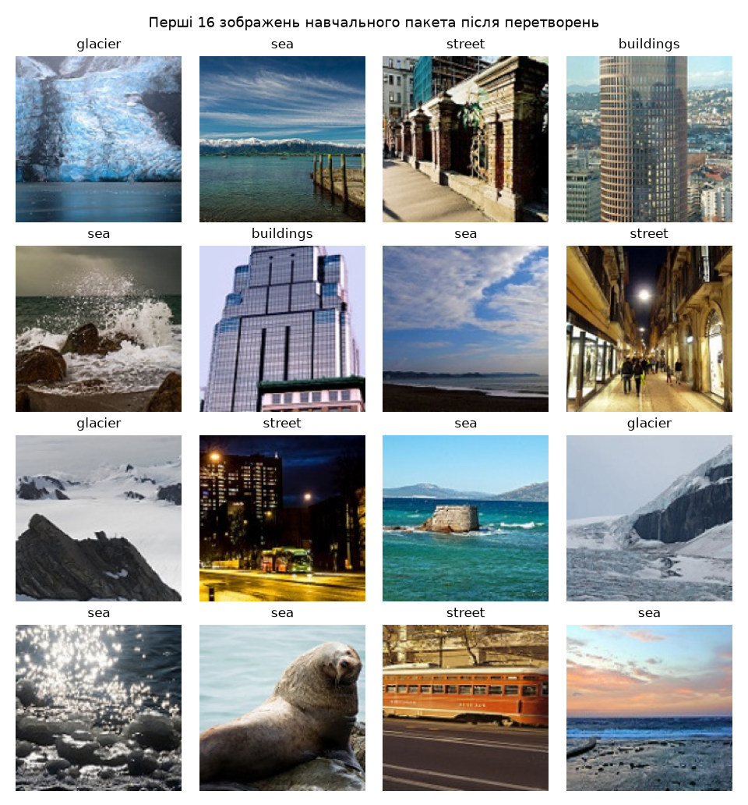
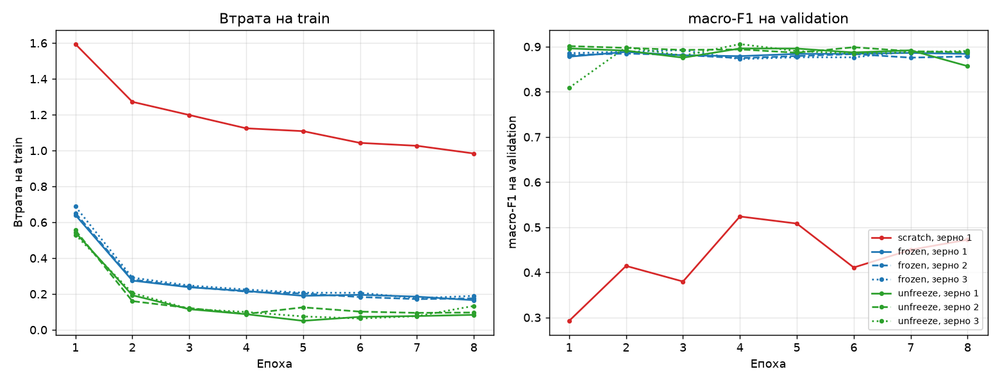
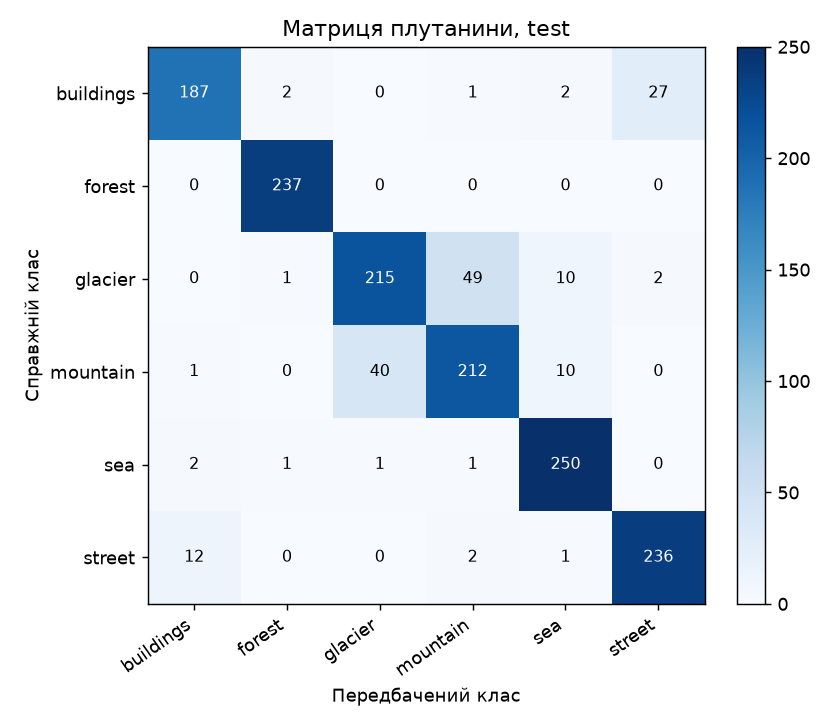
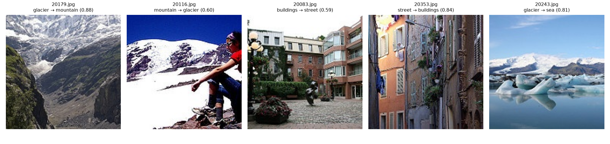

# ЛР3. Обчислювальний експеримент і трансферне навчання

**Виконала:** Артеменко Олександра

Задача: порівняти три режими навчання ResNet-18 (`scratch`, `frozen`, `unfreeze`) на малій вибірці Intel Image Classification (200 зображень на клас) за однакового бюджету в 304 кроки оптимізатора і з'ясувати, яку частину виграшу дають попередньо навчені ознаки, яку — донавчання кістяка, і чи більша кожна різниця за розкид між запусками.

Стек: Python 3.12, PyTorch 2.14.1, torchvision 0.29.1, NumPy 2.5.4, scikit-learn 1.9.1, Matplotlib 3.11.2, Pillow 13.0.0. Навчання й тестова оцінка — на CPU, float32.

---

## 1. Як запускати

### 1.1. Підготовка

Потрібен [uv](https://docs.astral.sh/uv/). Усі версії зафіксовано в `pyproject.toml` і `uv.lock`.

```bash
cd lab3
uv sync
```

Набір даних до репозиторію не додано. Завантажте [Intel Image Classification](https://www.kaggle.com/datasets/puneet6060/intel-image-classification) і розпакуйте архів. Шлях, який передається в `--data`, — це тека, де лежать `seg_train/seg_train/<клас>/` і `seg_test/seg_test/<клас>/`; `seg_pred` не використовується.

Ваги `ResNet18_Weights.IMAGENET1K_V1` torchvision завантажує сам під час першого запуску. Якщо інтернету немає, покладіть файл `resnet18-f37072fd.pth` у `~/.cache/torch/hub/checkpoints/` (у Windows `%USERPROFILE%\.cache\torch\hub\checkpoints\`).

### 1.2. Команда навчання

```bash
uv run python train.py --data /шлях/до/intel
```

Наприклад, у Windows, якщо набір розпаковано в теку на рівень вище за `lab3`: `uv run python train.py --data ..`

Команда будує `split.csv`, звіряє поділ із контрольною таблицею, виконує всі перевірки пунктів 1–2 і зупиняється з помилкою, якщо хоч одна не збіглася. Потім проводить сім запусків, записує журнали в `runs/`, вибирає конфігурацію за validation і зберігає `lab3_model.pt`. Test тут не завантажується. На CPU з двома потоками все займає близько 40 хвилин.

За замовчуванням результати пишуться в теку `lab3` і **перезаписують** збережені журнали. Щоб відтворити навчання, не чіпаючи їх, вкажіть іншу теку: `--out retrain`.

### 1.3. Команда аналізу

```bash
uv run python analyze.py --data /шлях/до/intel
```

Команда перевіряє, що SHA-256 файлу `split.csv` однаковий у всіх семи журналах і збігається з поточним файлом. Далі за журналами вона будує таблицю, криві й розклад ефектів і перевіряє, що `lab3_model.pt` відповідає правилу вибору. Лише після цього вона один раз обчислює на CPU логіти test, матрицю плутанини й п'ять помилок. Для аналізу іншої теки додайте `--root retrain`. Усі тестові числа в цьому README взято з виводу цієї команди (`analyze.log`, `analysis.json`).

### 1.4. Структура теки

| Файл | Призначення |
|---|---|
| `common.py` | константи, поділ, датасет і перетворення, `build_model`, `set_train_mode`, цикл епохи, оцінка |
| `train.py` | команда навчання (пункти 1–3, вибір у пункті 5) |
| `analyze.py` | команда аналізу (пункти 3–5) |
| `pyproject.toml`, `uv.lock`, `.python-version` | зафіксоване середовище |
| `split.csv` | поділ: `file`, `label`, `part`; рядки — train, потім validation, потім test |
| `split_check.json`, `checks.json` | результати перевірок пунктів 1–2 |
| `runs/<режим>_seed<зерно>/run.json`, `val_logits.npy` | журнали й логіти validation (1498 × 6) семи запусків |
| `lab3_model.pt` | ваги вибраного запуску (`state_dict`, `regime`, `seed`, `classes`, `img_size`), 45 МБ |
| `test_logits.npy`, `analysis.json` | логіти test і всі числа аналізу |
| `train.log`, `analyze.log` | вивід обох команд |
| `figures/train_batch.png` | пакет після перетворень |
| `figures/curves.png` | криві семи запусків |
| `figures/confusion_test.png` | матриця плутанини на test |
| `figures/test_errors.png` | п'ять характерних помилок |

Ваги шести невибраних запусків (`runs/*/model.pt`) зберігалися локально і до репозиторію не додані.

---

## 2. Протокол

**Поділ.** Для кожного класу беремо імена файлів, відсортовані як рядки. Train формується одним генератором `np.random.default_rng(0)` по класах у фіксованому порядку: `idx = np.arange(n_k)`, `rng.shuffle(idx)`, перші 200 індексів. Validation і test — новим `default_rng(0)` по класах `seg_test`: `idx[:n_k // 2]` іде у validation, решта в test. Далі дані завантажуються лише за `split.csv`, зображення відкриваються через Pillow з `.convert("RGB")`.

**Перетворення.** Train: `RandomResizedCrop(160, scale=(0.7, 1.0))` → `RandomHorizontalFlip()` → `ToTensor()` → `Normalize`. Validation і test: `Resize((160, 160))` → `ToTensor()` → `Normalize`. Статистики ImageNet `mean = (0.485, 0.456, 0.406)`, `std = (0.229, 0.224, 0.225)` використовуються в усіх режимах.

**Модель і режими.** `torch.manual_seed(seed)` і `np.random.seed(seed)`, потім `resnet18(weights=W)`, `fc = Linear(512, 6)` і `requires_grad=False` для всього, крім модулів, що навчаються. AdamW з `weight_decay=1e-4`; в оптимізатор передаються лише параметри, що навчаються.

| Режим | Ваги | Що навчається | Групи AdamW | У `eval()` під час навчання |
|---|---|---|---|---|
| scratch | випадкові | уся мережа | усі, 3·10⁻³ | — |
| frozen | ImageNet | `fc` | `fc`, 3·10⁻³ | `conv1`, `bn1`, `layer1`–`layer4` |
| unfreeze | ImageNet | `layer4`, `fc` | `fc`, 3·10⁻³; `layer4`, 3·10⁻⁴ | `conv1`, `bn1`, `layer1`–`layer3` |

**Цикл.** Train: `batch_size=32`, `shuffle=True`, `drop_last=False`, `num_workers=0`, перемішування з глобального генератора PyTorch. 8 епох × 38 кроків = 304 кроки. На початку кожної епохи викликається `set_train_mode`: `model.train()`, потім `.eval()` для модулів зі стовпця «У eval()». `CrossEntropyLoss` усереднюється за пакетом, втрата епохи дорівнює `Σ L_b·|b| / 1200`. Після кожної епохи — `model.eval()`, `torch.no_grad()` і macro-F1 на validation (`batch_size=64`, порядок як у `split.csv`). Підсумок запуску `F_{r,s}` — macro-F1 після 8-ї епохи. Розкладів швидкості, обрізання градієнта, змішаної точності, ранньої зупинки чи вибору епохи немає.

---

## 3. Перевірки до навчання (пункт 1)

### 3.1. Поділ

| Клас | train | validation | test |
|---|---|---|---|
| buildings | 200 / 1 996 761 ✓ | 218 / 4 837 323 ✓ | 219 / 4 837 559 ✓ |
| forest | 200 / 2 032 625 ✓ | 237 / 5 276 962 ✓ | 237 / 5 291 326 ✓ |
| glacier | 200 / 2 183 923 ✓ | 276 / 6 135 652 ✓ | 277 / 6 157 250 ✓ |
| mountain | 200 / 1 950 345 ✓ | 262 / 5 789 535 ✓ | 263 / 5 849 765 ✓ |
| sea | 200 / 1 987 613 ✓ | 255 / 5 655 068 ✓ | 255 / 5 668 011 ✓ |
| street | 200 / 1 841 817 ✓ | 250 / 5 541 845 ✓ | 251 / 5 547 533 ✓ |
| **Разом** | 1200 / 11 993 084 | 1498 / 33 236 385 | 1502 / 33 351 444 |

У кожній клітинці — «кількість / сума числових імен файлів». **Усі 18 клітинок збігаються з контрольною таблицею.** У `split.csv` 4200 рядків і 4200 унікальних імен, тож жоден файл не входить у дві частини.

SHA-256 `split.csv`: `2355c7d27aa1ee5ebd86f5d4a5fa396181a647cd0c5336a4f380ce965a3fd039`.

### 3.2. Пакет після перетворень



На рисунку — перші 16 зображень навчального пакета у тому вигляді, в якому їх отримує модель: після `RandomResizedCrop` і відзеркалення, з оберненим нормуванням (`x·std + mean`), з міткою над кожним. Кольори природні, отже нормування й обернене нормування узгоджені. Видно, що мітки відповідають змісту: льодовики, море, вулиці, будівлі.

### 3.3. Початкова втрата

Модель будувалася за кроками 1–5 із зерном 1. `L₀` рахувалася на першому пакеті навчального завантажувача після `set_train_mode`, під `torch.no_grad()`, до жодного кроку оптимізатора.

| Режим | L₀ | ln 6 |
|---|---:|---:|
| scratch | 2,048 | 1,792 |
| frozen | 1,924 | 1,792 |

Обидва значення трохи більші за ln 6, і це очікувано. Втрата дорівнює ln 6, лише якщо всі логіти однакові. Стандартна ініціалізація `Linear(512, 6)` дає ваги з `U(−1/√512, 1/√512)`, тому розкид логітів пропорційний нормі вектора ознак після `avgpool`. Ознаки після ReLU невід'ємні й мають помітну норму, тож логіти розходяться на десяті частки. Середня крос-ентропія за випадкових логітів більша за ln 6 (приблизно на половину їхньої дисперсії). Для `frozen` ознаки — це передобучені ознаки ImageNet. Для `scratch` вони йдуть із випадкової мережі через BN у режимі навчання і мають більший розкид, тому `L₀` вища. Відхилення на 0,1–0,3 не свідчить про помилку: значення порядку 3–5 вказували б на ненормовані входи або зламаний BN.

---

## 4. Перевірка режимів навчання (пункт 2)

Кожна перевірка починалася з нового екземпляра моделі, побудованого за кроками 1–5 зі зерном 1. Ці моделі ніде далі не використовуються.

### 4.1. Параметри

| Режим | Усього | requires_grad=True | Групи оптимізатора | Збіг |
|---|---:|---:|---|---|
| scratch | 11 179 590 | 11 179 590 | усі: 11 179 590, lr 3·10⁻³ | так |
| frozen | 11 179 590 | 3 078 | fc: 3 078, lr 3·10⁻³ | так |
| unfreeze | 11 179 590 | 8 396 806 | fc: 3 078, lr 3·10⁻³; layer4: 8 393 728, lr 3·10⁻⁴ | так |

Кількість параметрів — сума `numel()`. В усіх режимах сума параметрів у групах оптимізатора дорівнює кількості параметрів з `requires_grad=True`, а тензорів з `requires_grad=False` в оптимізаторі **0**.

### 4.2. Що змінюється за 5 кроків

Процедура така: копія повного `state_dict()`, далі `set_train_mode` і 5 кроків на перших 5 пакетах. Потім для кожного модуля окремо порівнювалися параметри і `running_mean`/`running_var` через `torch.equal`, без допуску.

| Режим | Модуль | Параметри змінилися | Ковзні статистики BN змінилися | Збігається з очікуваним |
|---|---|---|---|---|
| frozen | conv1 | ні | немає BN | так |
| frozen | bn1 | ні | ні | так |
| frozen | layer1 | ні | ні | так |
| frozen | layer2 | ні | ні | так |
| frozen | layer3 | ні | ні | так |
| frozen | layer4 | ні | ні | так |
| frozen | fc | так | немає BN | так |
| unfreeze | conv1 | ні | немає BN | так |
| unfreeze | bn1 | ні | ні | так |
| unfreeze | layer1 | ні | ні | так |
| unfreeze | layer2 | ні | ні | так |
| unfreeze | layer3 | ні | ні | так |
| unfreeze | layer4 | так | так | так |
| unfreeze | fc | так | немає BN | так |

Усі 14 рядків збігаються з очікуваним. Модулі в `eval()` повністю заморожені, а в модулях, що навчаються, змінилися параметри (і статистики BN у `layer4`).

### 4.3. Дослід із навмисною помилкою (frozen, `model.train()` замість `set_train_mode`)

**Прогноз (записано до запуску).** Параметри кістяка не зміняться: у них `requires_grad=False`, і їх немає в оптимізаторі. Змінюватимуться лише ваги `fc`. Натомість у всіх BN кістяка (`bn1`, `layer1`–`layer4`) зміняться `running_mean` і `running_var`: у режимі `train()` BN на кожному прямому проході нормує за статистиками пакета й оновлює ковзні середні. На кривій втрати train цього майже не видно. Під час навчання BN усе одно використовує статистики пакета, ознаки залишаються осмисленими, і втрата падає майже так само. Шкода проявиться під час оцінки: в `eval()` мережа нормуватиме за зсунутими ковзними статистиками, які не відповідають ні ImageNet, ні тому, до чого підлаштувалася `fc`.

**Результат.**

| Модуль | Параметри змінилися | Ковзні статистики BN змінилися |
|---|---|---|
| conv1 | ні | немає BN |
| bn1 | ні | **так** |
| layer1 | ні | **так** |
| layer2 | ні | **так** |
| layer3 | ні | **так** |
| layer4 | ні | **так** |
| fc | так | немає BN |

Максимальна абсолютна зміна в `layer1.0.bn1` після 5 кроків: **`running_mean` — 0,0928**, **`running_var` — 0,1203**. З правильним `set_train_mode` обидві зміни дорівнюють рівно 0.

Втрата на 5 кроках: з помилкою 1,887 → 1,946 → 1,844 → 1,684 → 1,407, з правильним режимом 1,924 → 1,765 → 1,614 → 1,387 → 1,289. Обидві криві спадають, а різниця менша за коливання між пакетами, тож за кривою train помилку не помітити. Результат повністю збігся з прогнозом.

**Чому `requires_grad=False` не захищає ці значення.** `running_mean` і `running_var` — це буфери, а не параметри. Їх оновлює не оптимізатор за градієнтом, а сам шар BN під час прямого проходу в режимі `train()` за правилом `r ← (1 − 0,1)·r + 0,1·μ_пакета`. Прапорець `requires_grad` стосується лише обчислення градієнтів, а чи оновлюються ковзні статистики, визначає тільки режим `train()`/`eval()` модуля. Тому заморожений кістяк треба переводити в `eval()` явно.

**Чому для `layer4` в `unfreeze` оновлення правильне.** Ваги згорток `layer4` змінюються під нову задачу, тож змінюється й розподіл активацій перед кожним BN цього блоку. Статистики ImageNet уже не описують ці активації. BN навчається в режимі `train()` (нормує за статистиками пакета) і має накопичити нові ковзні статистики, інакше під час оцінки нормування не відповідатиме тому, на чому навчалися ваги.

---

## 5. Сім запусків (пункт 3)

Усі сім запусків зроблено з того самого коміту коду (`7045856`, незакомічених змін у коді немає), на тому самому `split.csv` (хеш однаковий у всіх журналах). Пристрій — CPU (x86_64, 2 потоки), Python 3.12.3, PyTorch 2.14.1, torchvision 0.29.1.

| # | Режим | Зерно | Втрата train, епоха 8 | macro-F1 validation, епоха 8 | Час навчання, с |
|---:|---|---:|---:|---:|---:|
| 1 | scratch | 1 | 0,9839 | 0,4724 | 516,5 |
| 2 | frozen | 1 | 0,1655 | 0,8842 | 266,0 |
| 3 | frozen | 2 | 0,1757 | 0,8785 | 263,3 |
| 4 | frozen | 3 | 0,1896 | 0,8886 | 263,6 |
| 5 | unfreeze | 1 | 0,0837 | 0,8570 | 308,3 |
| 6 | unfreeze | 2 | 0,0967 | 0,8875 | 312,7 |
| 7 | unfreeze | 3 | 0,1333 | 0,8909 | 320,2 |

Час навчання — це сума 8 епох навчання разом з оцінкою validation після кожної епохи.



Режим frozen дає macro-F1 ≈ 0,88, що збігається з орієнтиром у завданні. Scratch далекий від вгадування (1/6 ≈ 0,17), але помітно слабший.

---

## 6. Розклад ефектів (пункт 4)

Формули:
- `F̄_r = (1/3)·Σ_s F_{r,s}`, `R_r = max_s F_{r,s} − min_s F_{r,s}`
- `R = max(R_frozen, R_unfreeze)`
- `Δ_pre = F̄_frozen − F_{scratch,1}`, `Δ_unf = F̄_unfreeze − F̄_frozen`
- `Δ_pre + Δ_unf = F̄_unfreeze − F_{scratch,1}`

| Величина | Значення |
|---|---|
| F̄_frozen, R_frozen | 0,8838; 0,0101 |
| F̄_unfreeze, R_unfreeze | 0,8785; 0,0338 |
| R | 0,0338 |
| Δ_pre | **+0,4113** (\|Δ_pre\| > R) |
| Δ_unf | **−0,0053** (\|Δ_unf\| ≤ R) |
| Δ_pre + Δ_unf | +0,4060 |

`F_{scratch,1}` = 0,4724.

**Інтерпретація.** Для Δ_pre: |Δ| = 0,411 більше за R = 0,034 приблизно в 12 разів, тож ефект вартий перевірки. За правилом він не доведений, але до межі шуму дуже далеко. Для Δ_unf: |Δ| = 0,005 не перевищує R = 0,034, тому **різниця між frozen і unfreeze не відрізняється від розкиду, результату немає.**

**Що змінює зерно в кожному режимі.** Зерно засіває глобальний генератор PyTorch, і від нього залежать три речі: (1) ініціалізація всіх випадково ініціалізованих ваг, (2) порядок пакетів у кожній епосі, (3) випадкові параметри `RandomResizedCrop` і `RandomHorizontalFlip`.
- У scratch зерно визначає ініціалізацію всієї мережі (11,2 млн параметрів), порядок пакетів і аугментації.
- У frozen кістяк фіксований (ваги ImageNet, BN в `eval()`), тож зерно впливає лише на ініціалізацію `fc` (3 078 параметрів), порядок пакетів і аугментації. По суті це логістична регресія на майже фіксованих ознаках: задача опукла за вагами `fc`, і різні зерна ведуть до близьких розв'язків. Звідси малий розмах 0,010.
- В unfreeze до цього додається траєкторія 8,4 млн параметрів `layer4`, що навчаються на 1200 зображеннях, а BN у `layer4` нормують за статистиками пакетів, які залежать від порядку пакетів. Модель встигає майже запам'ятати train (втрата 0,08–0,13), і її оцінка на validation коливається від епохи до епохи. Найпомітніше це в запуску 5: між 7-ю і 8-ю епохами F1 упав з 0,892 до 0,857. Тому розмах в unfreeze (0,034) утричі більший, ніж у frozen.

**Чому R не характеризує розкид запуску 1.** R виміряно на запусках 2–7, тобто на режимах з передобученим кістяком, де зерно впливає мало. У scratch зерно визначає всю ініціалізацію, а модель за 304 кроки ще далека від збіжності. Крива запуску 1 між сусідніми епохами стрибає до 0,14: 0,380 → 0,524 → 0,508 → 0,411 → 0,450 → 0,472. Отже, розкид scratch між зернами, найімовірніше, у кілька разів більший за R, і одне значення 0,472 — дуже неточна оцінка. Проте висновку щодо Δ_pre це не змінює. Навіть найкраща епоха scratch (0,524) на 0,36 нижча за найгірший запуск frozen (0,879), а сам ефект 0,41 на порядок більший за будь-яке правдоподібне коливання scratch.

**Чи однаковий бюджет за часом.** Ні. Бюджет однаковий за кількістю кроків оптимізатора (304), але не за часом. Scratch навчався 517 с, бо зворотний прохід іде через усю мережу. Frozen — ≈ 264 с, бо градієнт рахується лише для `fc`, а кістяк — це тільки прямий прохід. Unfreeze — ≈ 314 с, бо зворотний прохід іде тільки через `layer4`. У ці числа входить і однакова для всіх оцінка validation після кожної епохи. Тобто scratch отримав приблизно вдвічі більше обчислень, ніж frozen, і все одно відстав.

---

## 7. Вибір конфігурації і тестова оцінка (пункт 5)

**Вибір лише за validation.** Найбільше середнє F̄_r має frozen: 0,8838 проти 0,8785 в unfreeze і 0,4724 у scratch. Серед запусків frozen найбільше F_{r,s} має зерно 3 (0,8886). Його ваги збережено в `lab3_model.pt` (`regime="frozen"`, `seed=3`, `img_size=160`). Оскільки |Δ_unf| = 0,005 ≤ R = 0,034, **вибір між frozen і unfreeze визначив шум.** Процедура від цього не змінилася.

Команда аналізу перевірила, що `lab3_model.pt` відповідає правилу вибору за журналами. Вона також перерахувала на CPU macro-F1 цієї моделі на validation і отримала 0,8885955696 — точно як у журналі. Логіти збіглися із збереженими (максимальна різниця 0).

**Test, один раз, на CPU:**

- **macro-F1 = 0,8919**
- accuracy p = 0,8901, n = 1502
- стандартна похибка частки правильних відповідей √(p(1−p)/n) = **0,0081**

**Матриця плутанини** (рядки — справжній клас, стовпці — передбачений):

| | buildings | forest | glacier | mountain | sea | street |
|---|---:|---:|---:|---:|---:|---:|
| **buildings** | 187 | 2 | 0 | 1 | 2 | 27 |
| **forest** | 0 | 237 | 0 | 0 | 0 | 0 |
| **glacier** | 0 | 1 | 215 | 49 | 10 | 2 |
| **mountain** | 1 | 0 | 40 | 212 | 10 | 0 |
| **sea** | 2 | 1 | 1 | 1 | 250 | 0 |
| **street** | 12 | 0 | 0 | 2 | 1 | 236 |



**Порівняння з validation.** Macro-F1 на test (0,8919) на 0,0033 *вищий* за F_{frozen,3} = 0,8886 на validation, тож оптимістичного зміщення в наших числах не видно. Причини:
1. Зміщення від вибору найкращого з трьох запусків обмежене розкидом, з якого вибирали. У frozen розмах лише 0,010, тому навіть максимальний виграш від вибору — кілька тисячних. Вибір режиму frozen замість unfreeze теж зроблено за різницею 0,005.
2. Шум скінченної вибірки більший за це зміщення: похибка accuracy на test ≈ 0,008, і така сама за порядком похибка є у validation (n = 1498). Різниця між двома незалежними вибірками з такою похибкою легко сягає ±0,01 в будь-який бік. Тому зміщення порядку 0,003–0,005 «тоне» в шумі й може навіть змінити знак, як тут.

### 7.1. П'ять характерних помилок

П'ять найчастіших позадіагональних пар. Для кожної — перший за іменем (як рядок) файл test із такою помилкою.

| Файл | Справжній клас | Передбачений клас | Імовірність передбаченого класу | Кількість таких помилок у test |
|---|---|---|---:|---:|
| 20179.jpg | glacier | mountain | 0,8772 | 49 |
| 20116.jpg | mountain | glacier | 0,6007 | 40 |
| 20083.jpg | buildings | street | 0,5938 | 27 |
| 20353.jpg | street | buildings | 0,8439 | 12 |
| 20243.jpg | glacier | sea | 0,8065 | 10 |



- **20179.jpg (glacier → mountain):** сцена містить обидва класи — гірська долина зі схилами на передньому плані і язиком льодовика вгорі.
- **20116.jpg (mountain → glacier):** сцена містить обидва класи — засніжений гірський схил, де сніг і лід займають більшу частину кадру.
- **20083.jpg (buildings → street):** сцена містить обидва класи — житлові будинки навколо бруківчастого двору з ліхтарями, що однаково підходить і під «будівлі», і під «вулицю».
- **20353.jpg (street → buildings):** сцена містить обидва класи — вузька вулиця, яку майже повністю закривають фасади, тож модель бачить переважно будівлі.
- **20243.jpg (glacier → sea):** сцена містить обидва класи — уламки льоду в лагуні, а більшу частину кадру займає водна поверхня.

Плутанина glacier ↔ mountain (49 + 40 = 89 з 165 помилок) — властивість самого набору: льодовики знято в горах, засніжені гори виглядають як льодовики, і межа між класами в розмітці нечітка. Так само неоднозначна межа buildings ↔ street (27 + 12). Жодну з п'яти помилок не віднесено до «помилки моделі на однозначному зображенні».

---

## 8. Висновок

**Ефект попереднього навчання Δ_pre.** Напрям — позитивний: передобучені ознаки ImageNet із навчанням лише голови (frozen) дають значно вищу якість, ніж навчання з нуля. Величина — **+41,1 пункту macro-F1** (F̄_frozen = 0,884 проти F_{scratch,1} = 0,472). Ефект у 12 разів перевищує поріг шуму R = 3,4 пункту, тож він вартий перевірки, хоча за прийнятим правилом не доведений. Перевага стійка й поза формальним правилом: усі три запуски frozen (0,879–0,889) вищі за найкращу епоху scratch (0,524).

**Ефект розморожування Δ_unf.** Напрям — формально негативний: unfreeze у середньому трохи гірший за frozen. Величина — **−0,5 пункту macro-F1** (F̄_unfreeze = 0,879 проти F̄_frozen = 0,884). Це в шість разів менше за поріг шуму R = 3,4 пункту, тому **різниця не відрізняється від розкиду, результату немає.** Донавчання `layer4` не дало виміряного виграшу, але й не довело шкоди. Натомість воно втричі збільшило розкид між зернами (R_unfreeze = 3,4 проти R_frozen = 1,0 пункту).

Повний виграш трансферу відносно навчання з нуля — +40,6 пункту. Майже весь він пояснюється попередньо навченими ознаками. На test вибрана модель (frozen, зерно 3) дала macro-F1 = 0,892 при стандартній похибці accuracy ≈ 0,008, що узгоджується з validation.

Обидва ефекти виміряно за конкретного бюджету в 304 кроки оптимізатора (8 епох по 1200 зображень). Крива scratch на 8-й епохі ще не вийшла на плато, втрата train падає (0,98), тож із довшим навчанням scratch міг би скоротити відставання. Unfreeze за довшого навчання міг би або виграти, або сильніше перенавчитися.

Для нової задачі з 200 зображеннями на клас я взяла б **frozen**. Він дає ту саму якість, що й unfreeze, у межах шуму, має найменший розкид між запусками (1 пункт) і навчається найшвидше (≈ 264 с проти ≈ 314 с в unfreeze і 517 с у scratch).

---

## 9. Відтворюваність і відхилення

- Відхилень від фіксованих налаштувань немає. Усі параметри, зокрема ті, що лишилися за замовчуванням (параметри `RandomResizedCrop`, `betas`/`eps` AdamW, `momentum`/`eps` BN), записано в кожному `run.json`.
- Навчання й тест виконано на CPU. На іншій машині чи GPU значення macro-F1 можуть трохи відрізнятися, але поділ, конфігурація й відповіді «так / ні» в перевірках пункту 2 мають збігтися.
- **Хеш коміту.** Код писався й запускався в окремому локальному git-репозиторії: усі сім журналів містять коміт `7045856407b3548a5ae67c9672df1ea39073fc82` з `dirty=false`. Перед перенесенням у загальний репозиторій лабораторних цю локальну історію не перенесено, тому в репозиторії цей хеш відсутній. Код у теці `lab3` той самий, що й у коміті `7045856`, крім цього README.
- PyTorch на Linux встановлено з PyPI (`2.14.1+cu130`), але навчання йшло на CPU. На Windows uv поставить CPU-збірку тієї самої версії.

---
